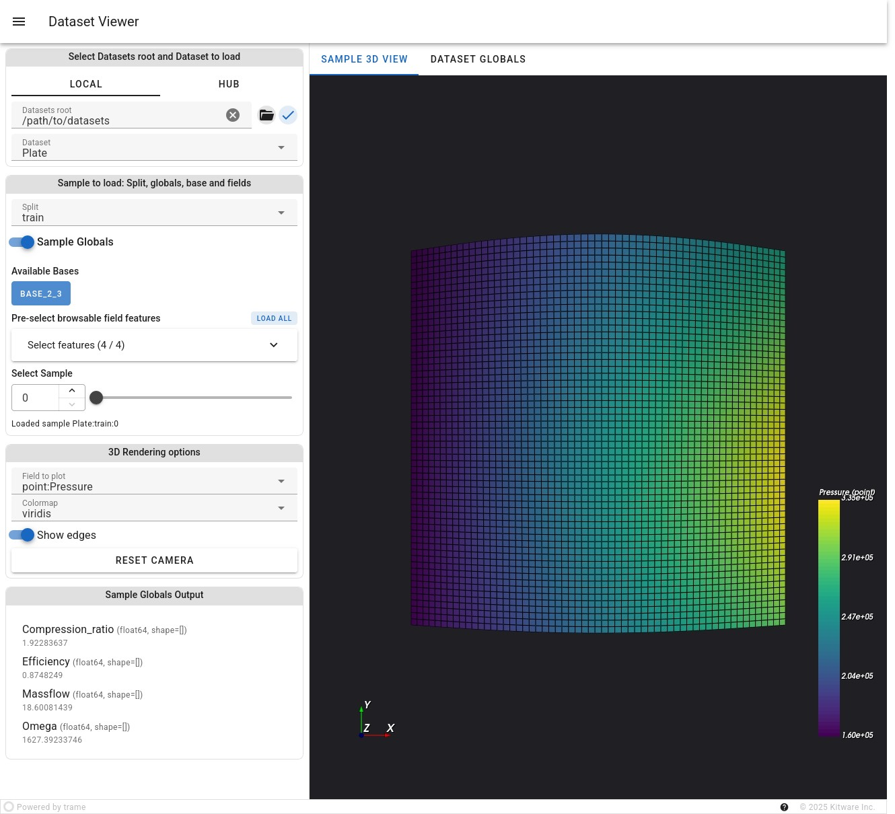
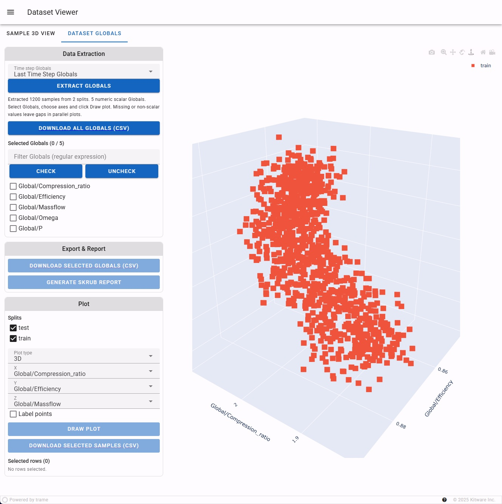
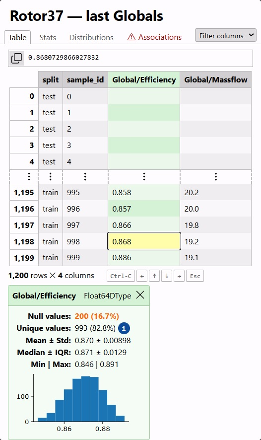

# Dataset viewer

`plaid-viewer` is a small web application for opening a PLAID dataset and
looking at its samples in 3D. It is meant for exploration: choose where the
data comes from, choose what part of the sample you want to see, then inspect
the mesh and fields interactively.

## Start the viewer

From a terminal, run:

```bash
plaid-viewer
```

From a `uv`-managed development checkout, use `uv run plaid-viewer` instead.

```bash
uv run plaid-viewer
```

You can also start directly from a local datasets folder:

```bash
plaid-viewer --datasets-root /path/to/datasets
```

Then open the address shown by the command, usually:

```text
http://127.0.0.1:8080/
```

Useful launch options:

| Option | What it does |
| --- | --- |
| `--datasets-root /path/to/datasets` | Opens a local folder containing PLAID datasets. |
| `--hub-repo namespace/name` | Adds a Hugging Face Hub dataset to stream. Can be repeated. |
| `--host 0.0.0.0` | Makes the viewer reachable from another machine. |
| `--port 8080` | Changes the web server port. |

## Follow the steps in the side panel



The left panel groups dataset selection, sample loading, rendering options,
and the current sample's Globals into separate cards.

### Select a datasets root and dataset

Choose where the datasets come from.

- **Local**: enter the path to a folder on your computer. You can also click
  the folder button to browse, then validate with the check button.
- **Hub**: enter a Hugging Face Hub repository name such as
  `PLAID-lib/VKI-LS59`, then click the plus button. Added Hub datasets appear
  as chips and can be removed from the same area.

If you started the viewer with `--datasets-root` or `--hub-repo`, the source may
already be filled in. The root controls and dataset selector may be hidden
independently when the viewer is configured to pin either choice.

Pick the **Dataset** you want to inspect.

The list depends on the selected source tab: local datasets are shown on the
**Local** tab, while streamed Hub datasets are shown on the **Hub** tab.

### Load a sample: split, Globals, base and fields

Choose a **Split**, for example `train`, `test`, or any other split provided by
the dataset.

Choose which high-level part of the sample to load:

- Click an **Available Bases** button to display its mesh. Click the active
  button again to deselect it.
- Enable **Sample Globals** to load global values associated with the sample.
  Loaded values appear in the **Sample Globals Output** card.

By default, the viewer starts light: it does not load every field immediately.
Pick a base and/or enable Sample Globals first, then choose fields.

This step is shown when the dataset exposes selectable fields, including
datasets streamed from the Hub.

Use it to choose which fields should be loaded for the selected base. This is
useful for large datasets because you can avoid loading everything at once.

- Click **Load all** to select every available field for the current selection.
- Expand **Select features** to tick only the fields you need.
- Click **Apply** after changing the checked fields.
- Click **Clear** to uncheck the current selection, then **Apply** to load no
  fields (the mesh can still be shown).

For streamed Hub datasets, choosing a Base initially loads only the mesh.
Select fields here and click **Apply** before **Next** to include them in the
stream. Applying a new selection restarts the stream from the first sample;
click **Next** again to load it with the selected fields.

### Select a sample

- For local datasets, enter a zero-based sample index in **Select Sample**,
  use its small +/− buttons to step one sample at a time, or drag the slider.
- For streamed Hub datasets, click **Next** to fetch the next sample. Streaming
  is forward-only: the viewer loads samples one after another instead of
  knowing the full list in advance.

The label under this control shows the current sample id, number of samples, or
streaming status.

### Configure 3D rendering

The **3D Rendering options** card appears when a base is selected. Choose a
**Field to plot** to color the 3D view.

Choose the field used to color the 3D view.

If no field is selected, the viewer still shows the mesh, but without scalar
coloring. When a field is selected, a color legend appears in the 3D view.

The same card also contains the colormap, edge visibility, and camera reset
controls described below.

## Explore Globals across splits

Switch from **Sample 3D View** to the **Dataset Globals** tab, choose **First Time
Step Globals** or **Last Time Step Globals** (last by default), and click
**Extract Globals**. This reads the selected time step's `Global/` values in
every sample of every local split; timeless Globals remain available. It does
not alter the feature selection used by the sample view. Changing the time step
discards the extracted Globals: click **Extract Globals** again to reload them.
Tick one or more
splits on the left and choose **1D**, **2D**, **3D**, or **parallel**. Scatter
plots use one, two, or three selectable numeric scalar Globals; in 1D the
horizontal axis is the sample index. Points use different colors and shapes
for each split. Enable **Label points** to annotate points with their sample
ID or another Global. Numeric Global arrays with multiple values are expanded
into scalar components named with 1-based suffixes (for example, `Global/foo_1`,
`Global/foo_2`). These components can be selected like other Globals. For
parallel coordinates, use the **Globals to plot**
checkboxes to select the numeric scalar Globals to display (all are selected
by default). Enter a regular expression in **Filter Globals** to show only
matching checkboxes; an invalid expression displays an error and matches
nothing. **Check** and **Uncheck** affect only the visible Globals, while
hidden selections remain unchanged. Clear the filter to show the full list
again. Different line styles and colors distinguish the selected splits.
Each parallel axis is scaled independently from 0 to 1 for comparison across
different units.

The Dataset Globals view below shows extracted values plotted in 3D, with
controls for choosing Globals, splits, plot axes, and exports on the left.



Use **Parallel renderer** to try either partial-line plotting (`lines`) or
Plotly's interactive `Parcoords` renderer. `Parcoords` requires a complete
numeric value for every selected Global, so samples with missing selected
values are omitted in that mode. After extraction, **Download all Globals
(CSV)** saves a table of every extracted sample across all splits, with
``split`` and ``sample_id`` columns and vector Globals expanded into numbered
components. With **Compare individual splits** off, click **Generate skrub
report** to open a standalone data-profiling report in a new browser tab.
Like the CSV export, the global report covers every extracted sample across
all splits, regardless of which splits are selected for plotting.
The report link is cleared when Globals are extracted again, the dataset or
time step changes, or the report mode is switched. Report generation may take
time for large tables; if it fails, the CSV and plots remain available.

The skrub report displays a table of extracted Globals and column statistics,
including missing-value counts and distributions, as shown below.



To compare splits, enable **Compare individual splits** before clicking
**Generate skrub report** (available when the dataset has at least two splits).
It builds one skrub report per extracted split and stacks them on a single
page, in extraction order. Switching tab
(Table, Stats, Distributions or Associations) in any report switches every
report to the same tab, so the distributions of, for example, `train` and
`test` can be read one below the other. This is a side-by-side view, not a
statistical test between splits.
Turn the switch off to generate a global report again. Changing the switch
clears the previous report link until a new report is generated.

In **1D** and **2D**, click points to toggle their selection, or
select multiple points with Plotly's box or lasso tools. In `parcoords`, brush
one or more axes to select lines.
**Download selected rows (CSV)** saves the selected plotted samples with the
same columns. **Selected rows** lists each matching split and sample ID,
with a count; the list scrolls when many rows are selected. The button is
disabled when no points are selected or no plotted lines match the brush.
Changing the plot or extracting again clears the selection and list.

All four plots use interactive Plotly views. Pan, zoom, reset, and export the
plot with the plot toolbar; rotate the 3D scatter with the mouse. In parallel
plots, hover over a point to see the original (unnormalized) Global value.

Extracted values are retained even if they are arrays or missing. Scatter
plots skip samples with missing, non-finite, or non-scalar values on the chosen
axes. Parallel plots show the available parts of each sample's line, leaving
gaps for missing axes and marking isolated values; samples without any
plottable values are skipped. Time-companion (`*_times`) columns are not plotted.
Extraction may take time for large datasets and the plot may be dense when
showing many samples.

**Streaming Hub datasets are not supported** in the Globals tab; the extract
button is disabled for these datasets.

## Time-dependent samples

If the selected sample contains several time steps, a **Time** slider appears
under the sample selector.

You can:

- move through time with the slider;
- press play/pause to animate the sample;
- press stop to go back to the first time step;
- toggle loop playback;
- adjust the playback FPS.

## Rendering options

The controls in **3D Rendering options** only change how the current sample is
drawn. They do not change which data is loaded.

- **Colormap** changes the colors used for the selected field.
- **Show edges** overlays mesh edges.
- **Reset camera** recenters the view after you rotate, pan, or zoom.

## Interacting with the 3D view

Use the mouse directly in the 3D area:

- left mouse button: rotate;
- middle mouse button, or `Shift` + left mouse button: pan;
- mouse wheel, or right mouse button drag: zoom.

The small axes marker in the corner helps you keep track of the orientation.

## Local datasets and Hub datasets

The viewer can open data from two places:

- **Local datasets** are read from disk and can usually be accessed in any
  order. The sample control is therefore a slider.
- **Hub datasets** are streamed from Hugging Face Hub. This avoids downloading
  the full dataset first, but samples are consumed forward with the **Next**
  button.

When streaming is active, a `streaming` chip appears in the toolbar.


## Troubleshooting

!!! tip "Viewer tips"
    - If the 3D view is empty, first select a button under **Available Bases**.
    - If the field dropdown is empty, load fields with **Load all** or by selecting
      features under **Pre-select browsable field features**. For Hub streams,
      click **Next** after applying the selection to fetch a sample with those
      fields.
    - If the viewer feels slow on a large dataset, load only one base and a small
      number of fields.
    - The message at the bottom of the side panel reports the latest action or
      error.
